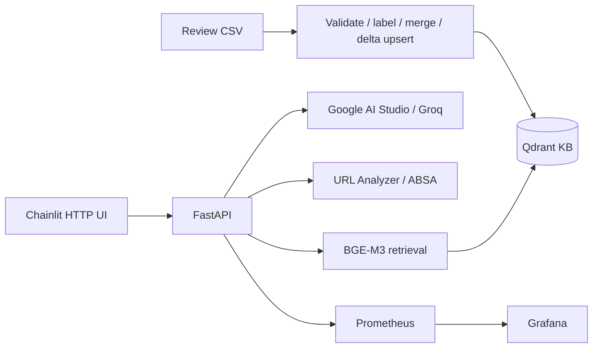

# Tiki Sentiment Chatbot RAG

[](https://github.com/KhoiDang-KHDL/Tiki-Sentiment-Chatbot-RAG/actions/workflows/ci.yml)

Hệ thống hỏi đáp sản phẩm Tiki kết hợp Retrieval-Augmented Generation và Aspect-Based
Sentiment Analysis. Repository giữ mã tham khảo trong `src/` và bổ sung runtime từ
[Tiki_ABSA](https://github.com/KhoiDang-KHDL/Tiki-Sentiment-Chatbot) trong `runtime/`.

## 1. Kiến trúc



| Code tree | Nội dung | Cách chạy |
|---|---|---|
| `src/` | Training, crawler, serving và Airflow/S3 pipeline tham khảo | `docker-compose.yml` |
| `runtime/` | API validation, HTTP UI, SSE, Google/Groq, metrics và incremental retry từ Tiki_ABSA | `docker-compose.runtime.yml` |

Hai stack dùng dependency và namespace riêng. Không chạy hai writer trên cùng dữ liệu/collection.
Runtime mới không tự thay thế các DAG của stack tham khảo.

## 2. Thành phần giữ từ bản tham khảo

- Crawler danh sách sản phẩm, chi tiết và reviews; preprocessing.
- ABSA training: LogReg, Random Forest, PhoBERT, TextCNN và BiGRU.
- ONNX export cho PhoBERT/BGE-M3; retrieval Qdrant và Redis cache.
- Airflow DAGs cho đồng bộ S3, preprocessing, inference và KB rebuild.
- MLflow/W&B integration trong pipeline/training; Ragas evaluation script.
- Docker Compose cho các service local; các báo cáo model JSON gốc.

Source gốc: [sentiment-chatbot-mlops](https://github.com/phngahn/sentiment-chatbot-mlops).
Provenance và danh sách thay đổi: [NOTICE.md](NOTICE.md), [PORTS.md](docs/PORTS.md).

## 3. Phần bổ sung từ Tiki_ABSA

| Phần bổ sung | Chức năng |
|---|---|
| HTTP UI | Chainlit gọi FastAPI; không load ML model hay giữ provider keys trong UI |
| Request validation | Giới hạn query/top-k/history, validate filters và URL |
| Streaming | SSE sources/token/done/error, phát hiện stream gián đoạn |
| Provider lifecycle | Lazy clients, Google/Groq selection, fallback trước token đầu |
| URL context | Context ID phía API, TTL một giờ, giữ sản phẩm cho câu hỏi tiếp nối |
| Retrieval | Collection qua env, kiểm tra vector, cache namespace theo model/encoder |
| Incremental KB | Backup/snapshots, stable IDs, idempotency và retry sau partial write |
| Metrics | Full-response latency, TTFT và semantic stream outcomes |
| Dashboard/alerts | Grafana provisioning; bốn Prometheus alert rules |
| Safe load test | Fixture riêng; chặn LLM thật mặc định |
| CI | Python 3.11/3.12 tests, static checks và Docker smoke |

Checkpoint resolver hỗ trợ `models/absa/v2/<model>/` của bản tham khảo và
`models/<model>/` của Tiki_ABSA. Xem [runtime setup](docs/RUNTIME.md).

## 4. ABSA và Knowledge Base

Sáu khía cạnh: chất lượng, giá cả, mô tả, dịch vụ, đóng gói và giao hàng.
Model outputs là negative/neutral/positive theo từng khía cạnh.

| Artifact | Path mặc định của bản tham khảo |
|---|---|
| LogReg bundle | `models/absa/v2/logreg/logreg.pkl` |
| PhoBERT checkpoint | `models/absa/v2/phobert/phobert.pt` |
| PhoBERT ONNX + tokenizer | `models/absa/v2/phobert_onnx/` |
| BGE-M3 ONNX + tokenizer, tùy chọn | `models/bge-m3-onnx/` |

KB dùng documents `product_card`, `aspect_summary`, `review`; dense vectors 1.024/Cosine.
Serving hiện truy vấn dense với metadata filters và ABSA reranking.
Runtime incremental yêu cầu collection có cả dense/sparse schema và không tự tạo lại collection.

Weights, dữ liệu và cache không có trong Git. Các JSON evaluation trong `models/`
là artifact của bản tham khảo, không phải kết quả đo lại của runtime mới.

## 5. Setup runtime mới

Prerequisites: Docker Linux containers/Compose, KB đã index hoặc snapshot để restore,
checkpoint/cache tương ứng. Các lệnh chạy từ repository root.

```powershell
git clone https://github.com/KhoiDang-KHDL/Tiki-Sentiment-Chatbot-RAG.git
cd Tiki-Sentiment-Chatbot-RAG
py -3.12 -m scripts.setup_runtime
```

Sửa `.env.runtime`: provider key, collection, ports và model settings.
Script sinh Grafana password ngẫu nhiên; không commit file env thật.

```powershell
.\scripts\runtime.ps1 build
```

Runtime Compose tạo Qdrant volume mới theo project `tiki-rag-runtime`.
Restore/index KB vào Qdrant này trước khi khởi động API, hoặc cấu hình đích Qdrant khác.
Nó không sử dụng hay thay đổi volume của dự án Tiki_ABSA đang chạy.

```powershell
.\scripts\runtime.ps1 start
.\scripts\runtime.ps1 check
.\scripts\runtime.ps1 status
```

API startup cần collection tồn tại. Clone/build không tự tạo dữ liệu/model.
Đường dẫn canonical, cách index và chuyển stack: [RUNTIME.md](docs/RUNTIME.md).

## 6. Services và endpoints

| Service | Port runtime mặc định |
|---|---:|
| FastAPI / Swagger | 8000 / `/docs` |
| Chainlit | 8001 |
| Qdrant | 6333 |
| Prometheus | 9090 |
| Grafana | 3000 |
| Locust, profile loadtest | 8089 |

Runtime host ports bind loopback; đổi trong `.env.runtime` khi máy đã có stack khác.

| Endpoint runtime | Chức năng |
|---|---|
| `GET /health` | Qdrant/provider configuration |
| `POST /search` | Retrieval, documents/sources, không gọi LLM |
| `POST /chat` | Answer/sources |
| `POST /chat/stream` | SSE sources/token/done/error |
| `POST /analyze` | URL report và context_id |
| `GET /metrics` | Prometheus metrics |

## 7. Testing và CI

```powershell
py -3.12 -m venv .venv-ci
.\.venv-ci\Scripts\python.exe -m pip install -r requirements-ci.txt
.\.venv-ci\Scripts\python.exe -m scripts.ci_checks
.\.venv-ci\Scripts\python.exe -X utf8 -m scripts.ci_tests
```

CI trên push/PR kiểm tra Python 3.11/3.12, cấu hình Compose/Prometheus, build HTTP UI và
API fixture, smoke test HTTP/SSE/metrics và UI → API. Không cần keys/model để chạy CI.
CI chưa xác nhận model thật, source DAG/S3 services hoặc full production ML image.

```powershell
.\scripts\runtime.ps1 locust
```

Locust mặc định trỏ fixture không gọi provider. Monitoring/load testing:
[monitoring/README.md](monitoring/README.md).
Không sao chép benchmark của Tiki_ABSA sang repo này như kết quả đã đo lại.

## 8. Ragas và experiment tracking

Giữ `scripts/ragas_eval.py` của bản tham khảo: faithfulness, answer relevancy và MLflow logging.
Script dùng Groq, API/dependency đời cũ và `src.chatbot.retrieval`; không tự đánh giá
runtime mới. Cần môi trường riêng và chủ động cho phép gọi provider khi chạy.

MLflow/W&B thuộc stack/pipeline tham khảo. Runtime mới chưa tích hợp evaluator Ragas
qua API hoặc tự động đưa incremental metrics vào MLflow.

## 9. Cấu trúc repository

```text
src/                         # Mã tham khảo: train, crawl, serving, KB
runtime/                     # Runtime bổ sung, namespace độc lập
  chatbot/                   # HTTP API/UI, retrieval, LLM, metrics
  absa/                      # Inference + checkpoint layout compatibility
  crawling/                  # Shared HTTP client, validation/error handling
  preprocessing/             # Cleaner dùng chung với inference
  knowledge_base/            # Resumable incremental update
scripts/                     # Export/eval gốc + runtime/CI commands
airflow/dags/                # Các DAG tham khảo
s3_lambda/                   # Labeling/S3 integration tham khảo
tests/                       # Runtime regression + Locust fixtures
monitoring/                  # Prometheus/Grafana configs
docker/                      # Original và runtime Dockerfiles
docker-compose.yml           # Stack tham khảo
docker-compose.runtime.yml   # Runtime bổ sung độc lập
.github/workflows/ci.yml      # CI; không deploy server
docs/                        # Runtime integration notes
```

## 10. Giới hạn

- Không có deployment server, CD hoặc hạ tầng cloud đi kèm repository này.
- Runtime API phục vụ local, chưa có authentication/rate limiting.
- Live Tiki/provider availability phụ thuộc mạng, quyền truy cập và quota.
- Không chạy original Airflow KB writer đồng thời với runtime incremental.
- Model compatibility, chất lượng ABSA/RAG và tải thực tế cần đánh giá trên artifact được cấp riêng.
