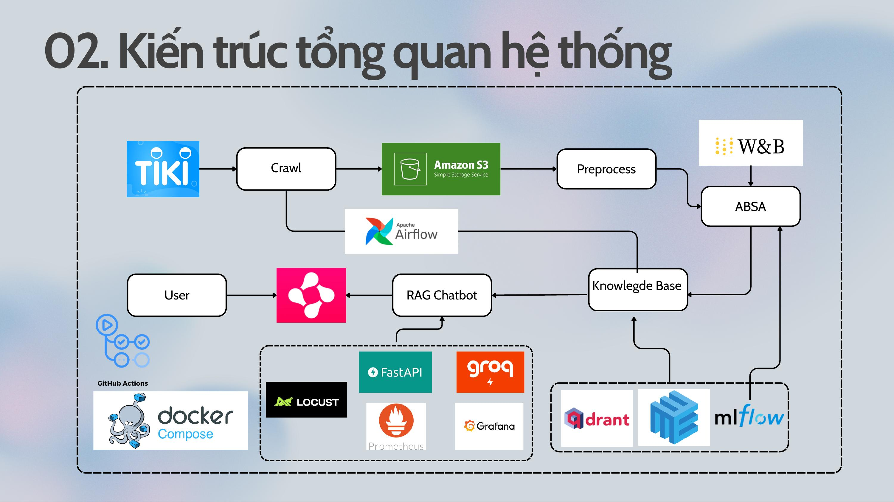
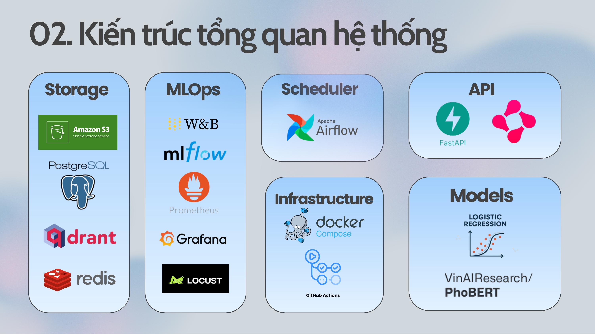
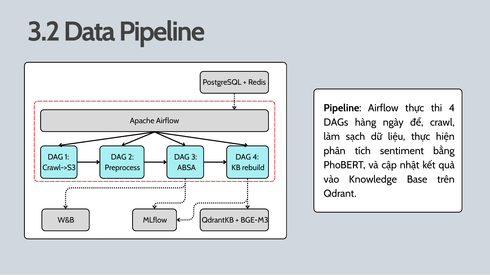
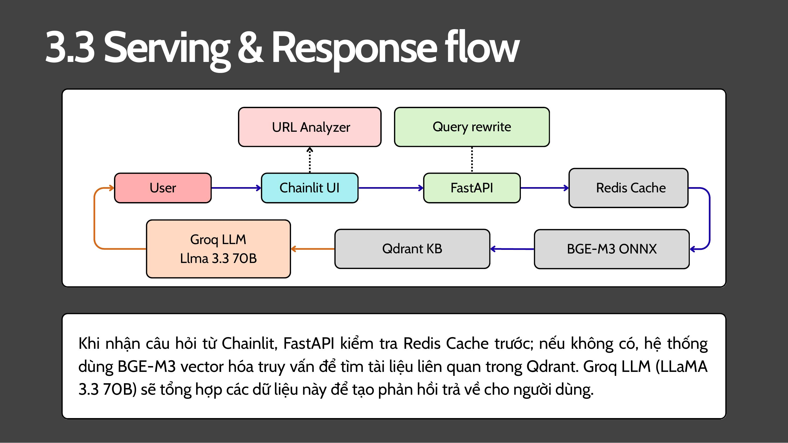

# 🛒 Tiki Sentiment Chatbot

[](https://www.python.org/)
[](https://fastapi.tiangolo.com/)
[](https://airflow.apache.org/)
[](https://www.docker.com/)
[](https://wandb.ai/cs317-mlops-org)

Hệ thống RAG Chatbot hỏi đáp sản phẩm Tiki kết hợp **Aspect-Based Sentiment Analysis (ABSA)**.
Người dùng có thể tìm kiếm sản phẩm, hỏi đáp theo ngữ cảnh hoặc gửi URL Tiki để nhận
phân tích đánh giá theo **6 khía cạnh**: chất lượng, giá cả, mô tả, dịch vụ, đóng gói và giao hàng.

Demo: [Video](https://drive.google.com/drive/folders/10pvr9gH1b9cp7Lck6WCGU8kd___Pctk3?usp=sharing)

## 1. Kiến trúc hệ thống



Hệ thống gồm ba luồng chính:

- **Data Pipeline:** thu thập review → làm sạch → ABSA inference → cập nhật Knowledge Base.
- **Model Serving:** truy xuất tài liệu sản phẩm → tổng hợp bằng LLM → trả lời có nguồn qua giao diện chat.
- **MLOps Infrastructure:** điều phối dữ liệu, experiment tracking, monitoring, load testing và CI/CD.



| Thành phần | Công nghệ |
|---|---|
| Backend / Frontend | FastAPI, Chainlit |
| ABSA | Logistic Regression, Random Forest, PhoBERT, TextCNN, BiGRU |
| Retrieval | BGE-M3, Qdrant, Redis cache tùy chọn |
| LLM cho HTTP serving | Google AI Studio, Groq |
| Orchestration | Airflow 2.7.3, CeleryExecutor, PostgreSQL, Redis broker |
| Tracking | W&B, MLflow |
| Observability | Prometheus, Grafana, Locust |
| Runtime / CI | Docker Compose, GitHub Actions; Python 3.11/3.12 |

## 2. MLOps Pipeline

### 2.1. Data Processing Pipeline



Airflow điều phối **5 DAG** theo lịch riêng, xử lý dữ liệu thông qua CSV và S3:

| DAG | Vai trò |
|---|---|
| `tiki_incremental_crawler` | Kiểm tra thay đổi sản phẩm và lấy review mới |
| `tiki_only_sync_s3` | Đồng bộ các CSV raw mới lên S3 |
| `preprocess_pipeline` | Download review, chuẩn hóa nội dung và loại trùng |
| `absa_inference_pipeline` | PhoBERT v2 PyTorch dự đoán sentiment theo từng khía cạnh |
| `kb_rebuild_pipeline` | Merge review, aggregate ABSA, tạo delta documents, cập nhật Qdrant và archive |

**Incremental Knowledge Base:** chỉ cập nhật tài liệu của các sản phẩm bị ảnh hưởng,
giữ vector của sản phẩm khác. Luồng xử lý batch hỗ trợ deduplication, stable document IDs,
backup/snapshots, kiểm tra payload và retry sau partial write.

Review được tổng hợp thành ba nhóm tài liệu: **product card**, **aspect summary** và
**review**. BGE-M3 tạo dense vector **1.024 chiều**, lưu trong Qdrant để phục vụ truy vấn.

**Retrain monitoring:** kiểm tra ngưỡng 250 review trong các file labeled pending và chỉ số
F1 từ W&B run history; ghi nhận tín hiệu retrain vào MLflow/W&B để theo dõi model.

### 2.2. Model Training & Optimization

Năm mô hình ABSA được tổ chức huấn luyện, tối ưu bằng **W&B Sweep** và đánh giá theo
F1 macro trên sáu khía cạnh:

| Model | Avg F1 macro — evaluation v2 | Vai trò |
|---|---:|---|
| **PhoBERT** | **84,76%** | ABSA inference trong data pipeline |
| Logistic Regression | 76,92% | Phân tích review với model mặc định của URL Analyzer |
| MultiHeadBiGRU | 74,80% | Baseline |
| MultiHeadTextCNN | 74,34% | Baseline |
| Random Forest | 72,08% | Baseline |

Các chỉ số lấy từ bộ kết quả evaluation v2 được lưu cùng repository.

**PhoBERT optimization:** learning rate 2e-5/5e-5, batch size 16/32, max length 128,
dropout 0.3/0.5, AdamW và early stopping. Training metrics và model artifacts được ghi
nhận trên W&B.

**ONNX export:** hỗ trợ xuất PhoBERT và BGE-M3 dense encoder để sử dụng với ONNX Runtime.
Checkpoint và tokenizer được tổ chức theo model/version, hỗ trợ lựa chọn khi inference.

### 2.3. Model Serving



**FastAPI** xử lý luồng hỏi đáp HTTP:

```text
Câu hỏi + lịch sử hội thoại
  → Query rewriting khi cần
  → BGE-M3 embedding
  → Qdrant dense search + metadata filtering
  → ABSA reranking
  → LLM generation
  → Streaming answer + sources
```

- Lọc sản phẩm theo giá, rating, loại tài liệu và điểm ABSA.
- Kết hợp nội dung truy xuất với lịch sử hội thoại để tạo câu trả lời có dẫn nguồn.
- Hỗ trợ Google AI Studio/Groq và provider fallback trước khi stream phát token đầu.
- Streaming qua SSE với các sự kiện sources, token, done và error.
- Theo dõi hội thoại bằng history do client gửi và URL context ID có TTL một giờ.
- HTTP API chạy một worker để quản lý model và URL contexts trong cùng tiến trình.

**Chainlit** cung cấp giao diện chat:

- Hội thoại nhiều lượt, hiển thị câu trả lời theo từng token và nguồn tham khảo.
- **URL Analyzer:** nhận URL Tiki → tìm báo cáo trong KB/cache hoặc crawl review → ABSA → báo cáo sản phẩm.
- Settings cho phép chọn LogReg, PhoBERT hoặc PhoBERT ONNX khi phân tích review mới.
- Hỏi tiếp về sản phẩm vừa phân tích, tìm sản phẩm thay thế và reset phiên bằng `/clear`.

**Qdrant Knowledge Base:** dense search với Cosine similarity, metadata filters và ABSA
reranking. Thống kê theo khía cạnh giúp kết quả tìm kiếm gắn với nội dung đánh giá sản phẩm.

### 2.4. Experiment Tracking

**W&B** quản lý training runs, hyperparameter sweeps, model artifacts và các tín hiệu
retrain từ pipeline ABSA.

**MLflow** tổ chức metrics và kết quả theo experiment:

| Experiment | Nội dung |
|---|---|
| `retrain_monitoring` | Số review và tín hiệu retrain |
| `kb_update` | Review mới, tổng review, affected products và smoke-test status |
| `ragas_evaluation` | Faithfulness, answer relevancy và kết quả từng mẫu |

### 2.5. Monitoring

**Prometheus** thu thập metrics từ HTTP API mỗi **5 giây**, lưu dữ liệu **15 ngày**
trong cấu hình runtime.

**Grafana** được provision datasource và dashboard **14 panel**, theo dõi:

- Availability, request rate, HTTP status và error ratio.
- Response latency p50/p95, active requests và thời gian đến token đầu (TTFT).
- Stream outcomes, stream duration, CPU và RAM của tiến trình API.

**Bốn alert rules:** API down, HTTP errors cao, stream failures cao và p95 latency cao.
Metrics streaming ghi nhận cả lỗi SSE phát sinh sau HTTP 200.

### 2.6. Load Testing & RAG Evaluation

**Locust** hỗ trợ năm workload: Health, Search, Chat, Streaming và Mixed.
Synthetic fixture phục vụ kiểm thử API/streaming; Search workload đo retrieval thật.
Báo cáo HTML, JSON và CSV tổng hợp throughput, failure ratio, latency và TTFT.

**Ragas** đánh giá chất lượng RAG trên question, answer và retrieved contexts:

| Metric | Ý nghĩa |
|---|---|
| Faithfulness | Mức độ câu trả lời được hỗ trợ bởi tài liệu truy xuất |
| Answer Relevancy | Mức độ câu trả lời giải quyết đúng câu hỏi |

Evaluation sử dụng Groq làm LLM judge, nhận dữ liệu log có contexts hoặc bộ 20 câu hỏi
sản phẩm. Kết quả được ghi vào MLflow để theo dõi theo từng lần chạy.
Luồng evaluator sử dụng retrieval trong `src/`; HTTP serving sử dụng `runtime/`.

### 2.7. CI/CD

GitHub Actions với **self-hosted runner** trên server nội bộ được cấp, trigger khi push lên `main`:

```
git pull → chmod -R 777 data/ → docker-compose build api ui
→ docker-compose up -d → restart airflow/scheduler/worker
→ smoke test API (retry 30 lần × 5s) + UI → ✅ done
```

### 2.8 Infrastructure

12 Docker Compose services trên shared network — server nội bộ được cấp (Ubuntu, 8 CPU, 9.7GB RAM):

| Service | Image | Port |
|---------|-------|------|
| tiki-api | custom FastAPI | 8000 |
| tiki-ui | custom Chainlit | 8001 |
| tiki-qdrant | qdrant/qdrant | 6333 |
| tiki-redis | redis:7-alpine | 6379 |
| tiki-airflow | custom Airflow webserver | 8080 |
| tiki-airflow-scheduler | custom Airflow | — |
| tiki-airflow-worker | custom Airflow | — |
| tiki-airflow-postgres | postgres:15 | 5432 |
| tiki-mlflow | ghcr.io/mlflow/mlflow:v2.11.1 | 5000 |
| tiki-prometheus | prom/prometheus | 9090 |
| tiki-grafana | grafana/grafana | 3000 |
| tiki-locust | locustio/locust | 8089 |


## 3. Kết quả đạt được

| Hạng mục | Kết quả |
|---|---|
| ABSA | Hoàn thiện training/evaluation cho 5 mô hình, phân tích 6 khía cạnh |
| PhoBERT v2 | Avg F1 macro **84,76%** theo evaluation artifact |
| Regression tests | **96/96 tests đạt**, 0 failures và 0 errors |
| Cross-version CI | Python **3.11 và 3.12** đều chạy thành công |
| Container integration | HTTP UI/API, search/chat, SSE success/error và metrics đạt smoke test bằng fixture |
| KB updates | Incremental affected products, stable IDs, backup/snapshots và retry |
| Observability | **14 dashboard panels**, **4 alert rules** và metrics cho HTTP/SSE |
| Evaluation | Pipeline chấm Faithfulness/Answer Relevancy và lưu kết quả MLflow |

## 4. Hướng dẫn cài đặt

### Chuẩn bị

Docker với Linux containers và Compose; Python 3.11/3.12 cho setup/test.
Chuẩn bị dữ liệu canonical, Qdrant snapshot hoặc documents để index, checkpoint/tokenizer
và provider key cho generation. Credentials S3/W&B được cấu hình theo môi trường dữ liệu.

### Clone và cấu hình

```bash
git clone https://github.com/KhoiDang-KHDL/Tiki-Sentiment-Chatbot-RAG.git
cd Tiki-Sentiment-Chatbot-RAG
python scripts/setup_runtime.py
```

Cập nhật `.env.runtime`: provider keys, collection, ports, model version và HF cache settings.
Setup tạo Grafana password ngẫu nhiên và các thư mục dữ liệu/log/report.

### Build và khởi động HTTP serving

```bash
docker compose --env-file .env.runtime -f docker-compose.runtime.yml build api ui
docker compose --env-file .env.runtime -f docker-compose.runtime.yml up -d qdrant
```

Restore KB snapshot hoặc index `data/processed/documents.jsonl`:

```bash
docker compose --env-file .env.runtime -f docker-compose.runtime.yml run --rm --no-deps \
  -v "${PWD}/data:/app/data" api python -m runtime.knowledge_base.index_qdrant
```

Khởi động và xác nhận kết nối:

```bash
docker compose --env-file .env.runtime -f docker-compose.runtime.yml up -d --wait
docker compose --env-file .env.runtime -f docker-compose.runtime.yml ps
docker compose --env-file .env.runtime -f docker-compose.runtime.yml exec -T ui python -m runtime.chatbot.container_check
```

### Data pipeline và tracking

Cấu hình `.env` từ `.env.example` cho S3/W&B/MLflow. Airflow, PostgreSQL, Redis broker
và MLflow được triển khai qua `docker-compose.yml`; API/UI HTTP và monitoring runtime
được triển khai qua `docker-compose.runtime.yml`. Chọn ports và KB writer phù hợp khi
vận hành các service trên cùng host.

Chi tiết thao tác: [Runtime setup](docs/RUNTIME.md) · [Monitoring](monitoring/README.md).

## 5. Kiểm thử

### Offline tests

```bash
python -m venv .venv-ci
source .venv-ci/bin/activate
python -m pip install -r requirements-ci.txt
python -m scripts.ci_checks
python -m scripts.ci_tests
```

### API và URL Analyzer

```bash
curl http://localhost:8000/health
curl -X POST http://localhost:8000/search -H "Content-Type: application/json" \
  -d '{"query":"sản phẩm chất lượng tốt","top_k":3}'
curl -X POST http://localhost:8000/analyze -H "Content-Type: application/json" \
  -d '{"url":"https://tiki.vn/product-p53497035.html","absa_model":"logreg"}'
```

Dùng context_id từ `/analyze` để hỏi tiếp về cùng sản phẩm; history được gửi cùng query.
Swagger tại `http://localhost:8000/docs` cung cấp schema và các endpoint chat/stream.

### Load testing

```bash
docker compose --env-file .env.runtime -f docker-compose.runtime.yml --profile loadtest up -d api-loadtest locust
```

Mở Locust, chọn workload và mức concurrency. Báo cáo sinh tại `reports/loadtest/`.

## 6. Truy cập services

| Service | Địa chỉ mặc định |
|---|---|
| Chatbot UI | http://localhost:8001 |
| API Docs | http://localhost:8000/docs |
| Qdrant | http://localhost:6333 |
| Grafana | http://localhost:3000/d/tiki-api |
| Prometheus | http://localhost:9090 |
| Locust | http://localhost:8089 |
| Airflow | http://localhost:8080 |
| MLflow | http://localhost:5000 |

Host ports cấu hình qua env/Compose. Credentials Grafana runtime lấy từ `.env.runtime`.

## 7. Các thành phần chính

| Thành phần | Nội dung |
|---|---|
| Model development | Dataset preparation, training, sweep, evaluation và ONNX export |
| Serving | API, Chainlit, retrieval, LLM, URL Analyzer và streaming |
| Data orchestration | Crawl, S3 sync, clean, ABSA inference và KB updates |
| Knowledge Base | Aggregate statistics, document building và Qdrant indexing |
| Observability | Metrics, dashboards, alert rules và performance testing |
| Automation | GitHub Actions regression và container integration checks |

## 8. Limitations

- **Domain hạn chế:** Knowledge Base chỉ chứa sản phẩm ngành Nhà cửa & Đời sống (~2,962 sản phẩm). Câu hỏi ngoài domain sẽ có chất lượng trả lời thấp hơn.
- **Rate limit:** Groq API giới hạn 25 RPM — bottleneck thực khi nhiều user đồng thời.
- **PhoBERT retraining:** Cần GPU để train lại, hiện dùng human-in-the-loop — DAG 3 phát hiện drift và gửi W&B alert để team can thiệp thủ công.
